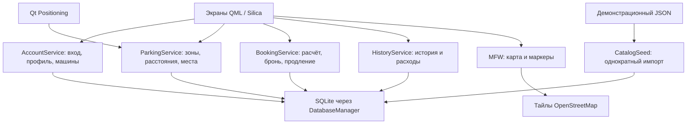

# Как устроена «Умная парковка» команды «ИИксперты»

Регламент текущей защиты: 5минут, без Q&A. Выступают Альберт, Матвей и Илья; распределение в PRESENTATION_PLAN.md. Этот подробный текст читают до выхода, не добавляют к выступлению.

Это разбор фактически собранного прототипа, а не обещаний из первоначального плана. Релиз: https://github.com/ggmaster913/smart-parking-aurora/releases/tag/v0.1.6. Код релиза — c2a077b602a5b73556899a6546dee66d5a359e13; исполняемые исходники совпадают с проверенной сборкой d4eef422. Среда: ОС Аврора 5.2.1.200, SDK MB2, Qt 5.6.3, x86_64.

## Что мы сделали и кому это нужно

Нативное приложение водителя: увидеть парковочные зоны, выбрать свободное место, заранее узнать сумму, получить демонстрационный талон и следить за оплаченным временем. Приложение сохраняет машину, активную парковку и историю между запусками.

Ключевая ценность прототипа — законченный пользовательский путь и сохранность состояния. Это проверенный фундамент для подключения настоящего каталога и оплаты. Мы не утверждаем, что уже интегрированы с городскими парковками или превосходим существующие приложения по измеренным показателям.

## Что настоящее, а что демонстрационное

Настоящие: нативный интерфейс Авроры, работа MFW с картографической подложкой OSM, локальная SQLite, расчёт стоимости, транзакции, сохранение сессий, история, запуск RPM в эмуляторе. QtPositioning подключён для координат; эмулятор может не давать реального GPS, поэтому есть явно обозначенная демо-позиция.

Демонстрационные: шесть парковочных зон, их занятость, подтверждение контакта кодом 123456 и успешная симуляция оплаты. SMS/письма не отправляются, банковские карты не собираются, деньги не переводятся. Интернет используется для подложки карты, а не для получения реальной занятости парковок.

ИИ помогал команде писать и проверять приложение. Это не означает наличие машинного обучения внутри приложения. В релизе нет LLM, нейросетевого прогноза мест или действующего ИИ-подбора.

## Пользовательский путь

1. Человек вводит телефон или email, проходит явно обозначенный демо-вход.
2. Добавляет госномер и марку автомобиля. Данные принадлежат текущему локальному пользователю.
3. Открывает карту или список зон. Видит адрес, часы работы, тариф и свободные места. При известной позиции показывается расстояние по прямой.
4. Выбирает зону и место. Экран подтверждения собирает машину, длительность и итоговую сумму.
5. Подтверждает демо-оплату. В одной транзакции создаются парковочная сессия и запись операции; показывается талон DEMO-… .
6. Видит остаток времени и может продлить парковку. Новый срок добавляется к прежнему сроку окончания.
7. После перезапуска видит ту же активную сессию. Может вернуться к зоне на карте и открыть историю расходов.

Если машины нет, оплата недоступна, предлагается добавить машину. Полностью занятая зона не позволяет выбрать место. Без сети список работает; отсутствие новых тайлов не превращает карту в полноценную офлайн-карту.

## Архитектура простыми словами

QML/Silica рисует экраны и передаёт выбранные ID. C++ проверяет правила и работает с данными. SQLite хранит состояние на устройстве. Общий корень main.cpp создаёт сервисы и передаёт их в QML; SmartParking.qml управляет переходами.

SessionContext хранит ID текущего пользователя. DatabaseManager открывает БД и применяет схему. CatalogSeed проверяет JSON и импортирует зоны/места один раз вместе с маркером версии. Следующий запуск не стирает пользовательские данные и не пересевает занятость.

Четыре главных сервиса:

| Сервис | За что отвечает |
|---|---|
| AccountService | Демо-вход, восстановление профиля, машины и корректный выход |
| ParkingService | Зоны и места, доступность с учётом активных сессий, координаты и расстояния |
| BookingService | Сумма, атомарная бронь, продление, активная сессия, завершение истёкшей парковки |
| HistoryService | Только чтение истории текущего пользователя и итогов расходов |

После изменения активной сессии обновляются доступность мест и история. Поэтому интерфейс не должен продолжать показывать только что занятое место свободным.

## Как считаются деньги

В БД и бизнес-логике деньги хранятся целыми копейками. Формула: округлить вверх до копейки тариф_в_час × минуты /60. Например,18000 коп./час ×60/60 =18000 коп., то есть 180 ₽. Продление на 15 мин стоит 4500 коп., то есть 45 ₽. Общая сумма сессии становится 225 ₽.

Длительность — от 15 мин до 24 часов, шаг 15 мин. В интерфейсе используются результаты C++-сервиса, а не второй независимый расчёт. Для точной передачи чисел в QML/JSON установлен предел 2^53−1 коп.; это технический предел представления, не реальный тариф продукта.

Стоимость продления берётся из тарифа, сохранённого в сессии. Изменение каталога позднее не должно задним числом менять согласованный тариф.

## Почему повторное действие не создаёт вторую оплату

У подтверждения операции есть operationId. Сервис сохраняет параметры запроса и полный ответ. Повтор с тем же ключом и параметрами возвращает сохранённый результат. Тот же ключ с другими параметрами отвергается как конфликт.

Это идемпотентность: повтор запроса не должен ещё раз создавать сессию или увеличивать сумму. Важная деталь: старый ответ хранится целиком, поэтому последующее продление не меняет результат повтора прежней операции.

Транзакции объединяют изменения: либо сессия и операция сохраняются вместе, либо изменения откатываются. Ограничения SQLite дополнительно запрещают две активные сессии одного пользователя и одновременное занятие одного места активными сессиями.

## Что хранится и как восстанавливается

users — локальные пользователи; vehicles — их машины; settings — активный пользователь и маркер импорта; zones/spaces — каталог; sessions — парковки; payment_operations — операции и сохранённые ответы.

Время хранится в UTC. Отсчёт вычисляется от срока окончания, а не от числа срабатываний таймера. Поэтому закрытие приложения не обнуляет парковку. При обновлении истёкшие сессии завершаются, место освобождается.

История показывает до 100 последних записей, но расходы считает по всем сессиям пользователя. Продление уже включено в сумму сессии: платежные операции второй раз к ней не прибавляются. При смене пользователя старые видимые данные сначала очищаются. Это локальная изоляция демо-профилей, а не подтверждённая сервером личность или готовая банковская система безопасности.

## Интерфейс и анимации

Карта и небольшая карточка зоны; цена и свободные места выделены, основной выбор понятен. Подтверждение показывает где, какая машина, на сколько и сколько стоит. Талон выглядит как билет. Активная парковка показывает крупный остаток и шкалу; предупреждение дополняется текстом, а не только цветом.

Анимации короткие и событийные: появление карточки, акцент выбранного места, вход талона. Тяжёлые бесконечные эффекты не были целью. Конкретный FPS и преимущество по производительности не измерялись, их нельзя обещать на защите.

## Что проверили

Илья собрал и установил общий RPM в эмулятор Авроры. Основной сквозной путь с 180 ₽, продлением 45 ₽ и историей 225 ₽ пройден на 0.1-4/0.1-5. Проверены занятая зона, список без сети/GPS, сохранение после перезапуска и выход.

В итоговом 0.1-6 дополнительно проверены обычный старт и восстановление после ошибки открытия БД через «Повторить». При ревью обнаружили, что root переходил раньше появления сервисов. Codex воспроизвёл ReferenceError настоящим QML-тестом и исправил порядок явным servicesReady после регистрации всех сервисов. Хостовый тест независимо прошёл 3/0, затем исправление проверено в целевом эмуляторе. Отдельная ошибка импорта JSON не воспроизводилась; весь основной сценарий на 0.1-6 заново не повторялся.

Проверки модулей отдельно покрывали ограничения схемы, деньги, повторные операции, владение машиной/сессией, выход при отказе записи и историю. Хостовый Qt 5.15 не заменяет целевой Qt 5.6; повторные прогоны не складываем в рекламное число тестов.

Установочный пакет: ru.iiexperts.SmartParking-0.1-6.x86_64.rpm. SHA-256: b31093fb9e350217bf6960055586842612cc81e4bf735364a0475fd36e96de0c.

## Границы и развитие

Нажатие маркера общей карты автоматизацией мыши не подтверждено; выбор через список и возврат к зоне работают. MFW не присылает отдельную ошибку, когда тайлы перестают загружаться, поэтому может оставаться кешированная размытая подложка. Нет реального парковочного API, настоящей оплаты, фоновых уведомлений и гарантированной офлайн-карты. Этап 4 полностью завершённым не называем: история и расходы есть, уведомлений нет.

«Ближе / Дешевле / Баланс» подготовлен отдельными правилами и сервисом в ветке feat/parking-recommendations, без интерфейса и вне релиза. Это объяснимое ранжирование по цене/расстоянию, не ML. Его нельзя показывать как готовую функцию текущего приложения.

Следующий разумный шаг — ручная проверка карты на устройстве, доведение уведомлений и пользовательских состояний, затем реальный каталог/занятость и платёжный провайдер. Для реального сервиса потребуются серверная авторизация, проверка актуальной доступности и подтверждённая оплата. Сроки на слайде — план команды, не доказанные результаты пилота.

## Кто что сделал

Григорий организовал работу и защиту; Codex делал core, контракты, координацию, проверки, retry-fix и финальное объединение. Claude Григория — BookingService. Матвей — SDK-каркас и первоначальный профиль/машины. Илья — карта, исправление профиля, общий корень/навигация, сборки и эмулятор, экспорт PDF. Альберт — дизайн и QML бронирования, история, отдельные правила подбора и презентация. Авторство и история сохранены.

## Шпаргалка для понимания проекта (не блок Q&A)

**Где здесь умная часть?** Прозрачный законченный сценарий, доступность с учётом сессий, сохранение, история и возвращение к зоне. Подбор подготовлен отдельно и пока не подключён. Нейросетевые функции не заявляем.

**Зачем Аврора, а не сайт?** Задача требовала нативное приложение; использованы Silica, MFW, QtPositioning и локальное хранение. Мы действительно собрали RPM и запустили его в Авроре.

**Оплата настоящая?** Нет. Это демонстрационная операция без банковских реквизитов. Надёжность повторных операций проверяется уже на этом прототипе.

**Без интернета работает?** Локальные данные, расчёт, история и список — да. Новые тайлы карты требуют сети; полноценную офлайн-подложку не заявляем.

**Что будет при закрытии приложения?** Активная сессия хранится в SQLite, остаток пересчитывается от сохранённого срока. Фоновое уведомление при этом не реализовано.

**Можно ли одним местом воспользоваться дважды?** Мок-занятость и активные сессии учитываются при выборе и проверяются транзакционно при бронировании; есть ограничения SQLite. Реальной информации с улицы прототип не получает.

**Почему не подключили всё сразу?** За время хакатона приоритетом были работающий нативный путь, сохранность данных и проверка целевой сборки. Не реализованные части обозначены явно.

Публикация на Мос.Хаб отложена прямым решением Григория. Готовый GitHub Release и документы не означают завершённую конкурсную сдачу.
